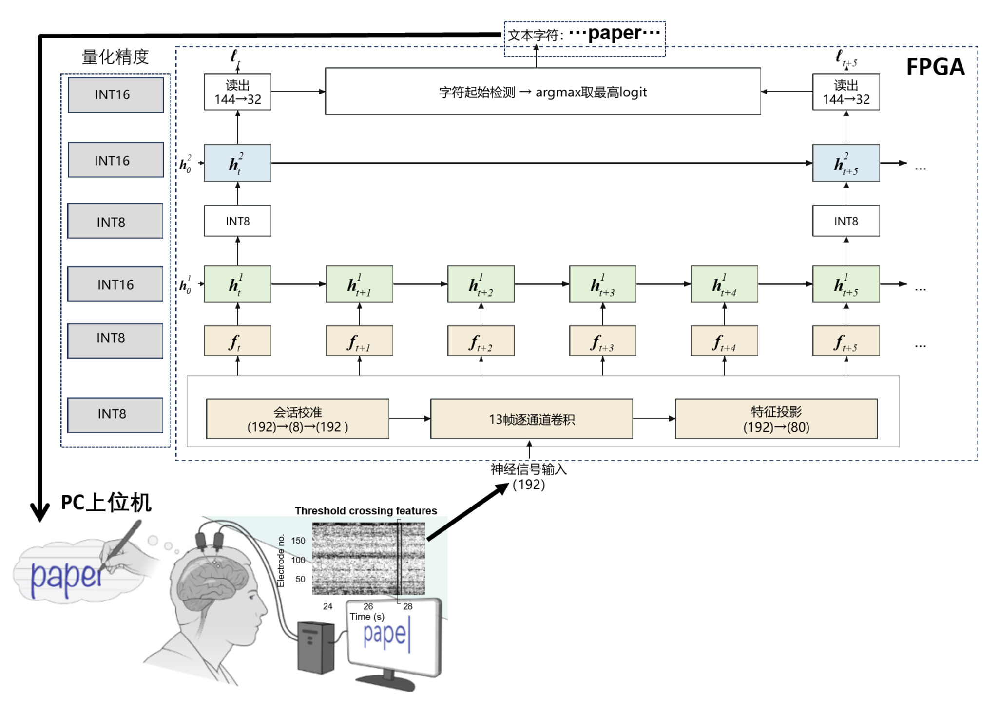
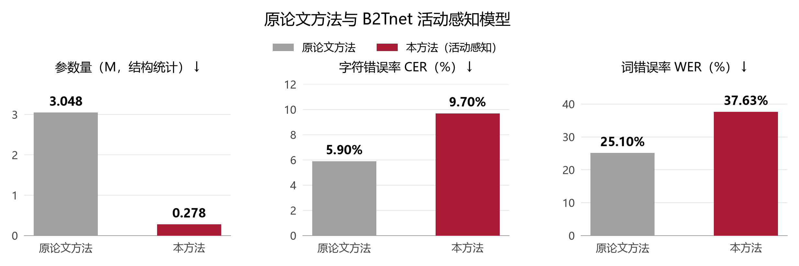

# B2Tnet

本队伍基于 PYNQ-Z2（Zynq XC7Z020-CLG400-1）的脑控手写解码系统，将 192 通道神经活动特征转换为文本，完成从模型定点化、Verilog RTL 实现到 FPGA 上板解码与浏览器演示的完整流程。

输入采用 Willett 公开数据集中已提取、预处理的植入式神经活动特征。PC 负责数据准备与 UI 展示，Zynq PS / ARM 负责 DMA 调度和字符判决，FPGA PL 执行定点神经网络推理。

## 系统与方法



板端实现中，PL 输出 32 路 logits，字符起始检测及文本判决由 PS / ARM 完成。

网络主要创新点为：采用低秩会话校准、逐通道时域卷积、特征投影和双层多速率 GRU

```text
192 通道 INT8 特征
  → 残差会话校准：192 → 8 → 192
  → 13 点逐通道时域卷积
  → 特征投影：192 → 80
  → GRU1：H144，每 20 ms 更新
  → 每 5 步抽取一次，H16 → INT8 再量化
  → GRU2：H144，每 100 ms 更新
  → 读出：144 → 32 路 INT16 logits
  → PS 端字符起始检测与延迟判决
  → 文本输出与 UI 展示
```

- **减少矩阵规模**：秩 8 残差校准与 192 → 80 特征投影，降低会话映射和 GRU 输入矩阵的计算与存储需求。
- **降低递归计算开销**：双层隐藏维度均为 144，第二层以第一层的 1/5 频率更新。
- **采用定点计算**：INT8 权重与矩阵输入、INT16 递归状态、INT32 矩阵累加器，配合 512 项 Sigmoid / Tanh 查找表。

活动感知：根据 GRU 输入变化和已完成的隐藏状态变化选择门精度。

## 实验结果

### 原论文方法与 B2Tnet 活动感知模型

| 方法 | 参数量（本地结构统计）↓ | CER ↓ | WER ↓ |
| --- | ---: | ---: | ---: |
| 原论文 GRU（Willett et al., Nature 2021；Raw online） | 3,048,352 | 5.90% | 25.10% |
| **B2Tnet（活动感知精度，FPGA）** | **278,416** | **9.6988%** | **37.6260%** |

原论文识别指标取自 [Table 1 的 Raw online output](https://pmc.ncbi.nlm.nih.gov/articles/PMC8163299/#T1)，B2Tnet 在官方 HeldOutBlocks 228 句上完成 FPGA 回放测试。按本地结构统计，B2Tnet 参数量减少 **90.87%（10.95×）**。



B2Tnet 活动感知模型已完成全部 228 句 FPGA 测试，3,457,568 个 INT16 输出与对应整数参考逐位一致。识别误差统计见 [software_summary.json](board/results/software_summary.json) 的模式 2，完整板测记录见 [board_results.json](board/results/board_results.json)。

### 计算与存储开销

| 指标 | 原论文结构的本地复现 | B2Tnet 活动感知模型 | 降低倍数 |
| --- | ---: | ---: | ---: |
| MAC / 20 ms 输入帧 | 1,438,553.6 | 143,500.8 | 10.02× |
| 矩阵权重存储 | 11.594 MiB（FP32） | 0.262 MiB（INT8） | 44.31× |

### FPGA 实现与演示

| 指标 | 活动感知版本 |
| --- | ---: |
| 目标器件 | XC7Z020-CLG400-1 |
| PL 工作频率 | 50 MHz |
| LUT | 24,765（46.55%） |
| FF | 24,907（23.41%） |
| BRAM Tile | 77（55.00%） |
| DSP | 12（5.45%） |
| 布局布线 WNS / WHS | +1.059 ns / +0.046 ns |
| 228 句板测输出位差 | 0 |
| Vivado vectorless 功耗估计 | 1.501 W |

浏览器界面展示神经活动波形与逐步生成的文本。以下结果来自实际 DMA 传输和 FPGA 推理，耗时为离线回放事务时间。

| 解码文本 | 信号时长 | PL 时钟 | 实测耗时 | 与整数参考位差 |
| --- | ---: | ---: | ---: | ---: |
| you wish to purchase something? | 27.82 s | 5 MHz | 21.49 s | 0 |
| imagine all the people living life in peace | 32.74 s | 50 MHz | 2.59 s | 0 |

资源与时序报告位于 [build/reports](build/reports/)，演示测试记录位于 [demo_validation_20261103.json](board/results/demo_validation_20261103.json)。

## 仓库结构

```text
pynq-gru-bci/
├── README.md
├── src/
│   ├── pl/
│   │   ├── rtl/              # GRU 核、活动感知门精度、AXI 接口等 RTL
│   │   ├── ip/               # 封装的自定义 IP
│   │   └── constraints/      # XDC 约束
│   └── ps/
│       ├── driver/           # 加速器驱动与寄存器操作
│       ├── preprocess/       # 数据准备与导出说明
│       ├── utils/            # 流式字符判决等工具
│       └── model/            # 网络、QAT 与整数参考模型
├── sim/
│   ├── testbench/            # RTL 测试平台
│   ├── scripts/              # XSim 自动化脚本
│   └── results/              # 仿真日志与输出对比
├── build/
│   ├── scripts/              # Vivado 工程构建与 IP 封装 Tcl
│   └── reports/              # 综合、布局布线、资源与时序报告
├── board/
│   ├── bitstream/            # .bit 与 .hwh
│   ├── scripts/              # 板端服务与 PC 浏览器 UI
│   └── results/              # 板测记录、准确率统计与演示排序
├── data/
│   ├── eeg_dataset/          # 数据输入目录，实际为植入式神经活动特征
│   └── golden_ref/           # 冻结权重、ROM、参考输出与测试向量
├── skill/
│   ├── README.md             # 技能包说明
│   ├── prompt_workflow/      # 技术提示工作流
│   ├── case_templates/       # 可复用实验模板
│   ├── verify_scripts/      # 完整性与隐私检查
│   ├── pitfall_list/         # 结构化踩坑清单
│   └── pynq_common_skill/    # 通用 PYNQ Skill
└── report/
    ├── design_report.pdf     # 设计报告
    ├── design_report.docx    # 可编辑报告
    ├── llm_trace/            # 协作流程说明
    └── figures/              # 系统、架构与性能配图
```

## 环境要求

| 环节 | 环境 |
| --- | --- |
| 本地整数参考 | Python 3.10+、NumPy、Numba |
| 原始数据导出 / 可选 QAT | 额外安装 PyTorch、SciPy |
| RTL 仿真与构建 | Vivado Design Suite 2025.2，安装 Zynq-7000 器件支持 |
| 板端运行 | PYNQ-Z2、PYNQ 3.0.1、MicroSD、Micro USB 数据线、以太网 |
| 演示界面 | PC 浏览器，与板卡网络互通 |

比特流可直接加载至 PYNQ-Z2，由板端执行推理，PC 浏览器展示解码过程。

## 复现步骤

以下 PC 命令在仓库根目录执行；示例使用 Windows PowerShell。

### 1. 获取代码

```powershell
git clone <REPOSITORY_SSH_URL> pynq-gru-bci
cd pynq-gru-bci
python -m pip install -r requirements.txt
python skill/verify_scripts/verify_repository.py
```

将 `<REPOSITORY_SSH_URL>` 替换为仓库 Code 菜单中复制的 SSH 地址。使用源码 ZIP 时，解压后直接进入 `pynq-gru-bci/`，从安装依赖开始执行。


### 2. 准备测试输入

原始数据从 [Dryad](https://doi.org/10.5061/dryad.wh70rxwmv) 获取。将已导出的 `official_traces` 放入以下位置：

```text
data/eeg_dataset/official_traces/
├── manifest.json
├── official_000.npz
├── ...
└── official_227.npz
```

<details>
<summary>从原始数据导出 official_traces</summary>

准备数据集目录、官方 TrainingSteps 目录（包含 `Step2_HMMLabels/HeldOutBlocks` 和 `trainTestPartitions_HeldOutBlocks.mat`），并将下面示例路径替换为实际位置。

```powershell
python -m pip install torch scipy
$env:PYTHONPATH = (Resolve-Path src/ps/model).Path
python -c "from paper_v5_pipeline import prepare_paper_v5_label_cache_official; prepare_paper_v5_label_cache_official(data_root='D:/BCI/Datasets', training_steps_root='D:/BCI/TrainingSteps', cache_path='data/eeg_dataset/paper_v5_label_cache.pt', cv_part='HeldOutBlocks')"

python src/ps/model/export_h144_official_board_traces.py `
  --data-root D:/BCI/Datasets `
  --label-cache data/eeg_dataset/paper_v5_label_cache.pt `
  --checkpoint data/golden_ref/checkpoints/fpga_candidate.pt `
  --output-dir data/eeg_dataset/official_traces
```

导出程序执行预处理、输入量化与整数参考推理，并检查官方留出集为 228 句。输入目录说明见 [data/eeg_dataset/README.md](data/eeg_dataset/README.md)。

</details>

### 3. 整数评估与 RTL 仿真

准备好测试输入后，执行句子级整数评估：

```powershell
python src/ps/model/run_precision_eval.py
```

结果写入 `board/results/software_official/` 和 `board/results/software_summary.json`。脚本会复用已存在的逐句结果；从头计算时，先将 `software_official/` 改名备份，再执行命令。

RTL 核心回归使用仓库附带的测试向量。将 `VIVADO_BIN` 替换为本机安装路径：

```powershell
$env:VIVADO_BIN = 'D:/2025.2/Vivado/bin'
python sim/scripts/simulate_activity.py
```

测试覆盖高精度、静态混合精度和活动感知三种配置，合计核对 1,248 个 logits 及活动计数；结果写入 `sim/results/`。

### 4. 构建 FPGA 工程（可选）

在已配置 Vivado 命令行环境的终端中执行：

```powershell
vivado -mode batch -source build/scripts/build_overlay.tcl
```

在独立 checkout 中运行脚本，生成 `build/vivado_project/`、`board/bitstream/h144_dma_overlay.bit` 和同名 `.hwh`，并将报告写入 `build/reports/`。

自定义 IP 位于 `src/pl/ip/h144_accel/`，可加入 Vivado IP Catalog。源码中的 `h144` 为硬件模块与比特流的命名。

### 5. 启动板端解码与 UI

将仓库及 `official_traces/` 复制到板卡的 `/home/xilinx/jupyter_notebooks/pynq-gru-bci/`。在板端终端执行：

```bash
cd /home/xilinx/jupyter_notebooks/pynq-gru-bci
sudo bash
source /etc/profile.d/xrt_setup.sh
/usr/local/share/pynq-venv/bin/python board/scripts/board_server.py \
  --overlay-dir board/bitstream \
  --trace-dir data/eeg_dataset/official_traces \
  --golden data/golden_ref/activity_golden_all.npz \
  --ranking board/results/demo_ranking.json \
  --counters data/golden_ref/expected_activity_counters.json \
  --log-dir board/results/live --host 0.0.0.0 --port 8765
```

PC 端另开终端，在本地仓库根目录执行；板卡 IP 与示例不同时，修改 `--board-api`：

```powershell
python board/scripts/serve_ui.py --board-api http://192.168.2.99:8765 --port 8766
```

浏览器打开 **http://127.0.0.1:8766/**，点击“开始解码”。界面默认 5 MHz，可选择 50 MHz；文本由 FPGA 返回的 logits 经 PS 判决生成，输出与整数参考、活动计数一致后显示“校验通过”。日志保存在 `board/results/live/`。

演示按 WER、CER 从低到高排列，同分按信号时长和原记录号排序。整体准确率由全部 228 句的解码结果计算。

## 项目资料

- [最终实验报告 PDF](report/design_report.pdf) · [Word 原稿](report/design_report.docx)
- [最终网络结构图 PNG](report/figures/b2tnet_architecture_final.png) · [可编辑框图源文件](report/figures/B2Tnet_editable_figures.pptx)
- [最终交付说明](RELEASE.md)

数据与原始研究：[Willett et al., Nature 2021](https://doi.org/10.1038/s41586-021-03506-2) · [Dryad 数据集](https://doi.org/10.5061/dryad.wh70rxwmv)。相关硬件工作：[Shaeri et al., MiBMI, JSSC 2024](https://doi.org/10.1109/JSSC.2024.3443254)。
